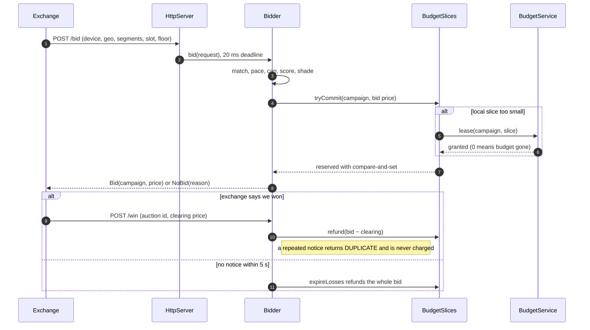

# java-bidder: a mini demand-side bidder in plain modern Java

**Live demo: https://henryzhangpku.github.io/java-bidder/** (in-browser simulation; see below)

A small demand-side (DSP) bidder for real-time ad auctions: an in-memory campaign
index, frequency caps, leased budget slices, a pacing controller, a logistic score, first-price
shading, and a hard deadline. Plain JDK 21, no frameworks, so what you read is the language.
About 1,050 lines of main code plus 370 lines of tests.

**Coming back to Java after years of Python?** Read [docs/java-since-2015.md](docs/java-since-2015.md)
first: what changed from Java 7/8 to 21+, side by side with the Python you know.

## How it fits together


Solid arrows are the hot path inside one bid; dotted arrows are background jobs that only publish
values the hot path reads (no control loop inside a bid). One auction, start to finish:



## Run it (one command)

```bash
./mvnw -q compile exec:java        # http://localhost:8080  (port arg: -Dexec.args=9090)
./mvnw test                        # 21 tests, ~5 s
```

The GitHub Pages demo can't run a JVM, so the same page falls back to a JavaScript port of the
pipeline (same steps and constants, single-threaded). Run the server locally and the page talks to
real Java instead; the banner at the top tells you which mode you're in.

Open http://localhost:8080 and press **Send 1,000 requests**. The page acts as the exchange: it
sends 1,000 bid requests with 50 in flight, posts wins for about 40% of bids, and re-sends about
5% of win notices to test idempotency. Click 3-4 times quickly and the **Throttle** column drops:
the campaigns are now ahead of the 5-minute "day" and pacing pushes back. 1% of requests simulate
a slow dependency, so TIMEOUT is never zero and p99 sits near the 20 ms deadline: the deadline
caps the tail.

By hand:
```bash
curl -s -XPOST localhost:8080/bid -d '{"auctionId":"x1","deviceId":"d1","app":"a","slotSeconds":30,
  "geo":"US-CA","segments":["sports"],"floorCpm":3}'
# {"priceCpm":12.988,"auctionId":"x1","campaignId":"c4","score":0.78,"bid":true}
curl -s -XPOST localhost:8080/win -d '{"auctionId":"x1","campaignId":"c4","clearingCpm":12.0}'   # RECORDED
curl -s -XPOST localhost:8080/win -d '{"auctionId":"x1","campaignId":"c4","clearingCpm":12.0}'   # DUPLICATE
curl -s localhost:8080/stats
```

## 10-minute tour, in reading order

| # | file | what it is in the bidder | Java to notice |
|---|---|---|---|
| 1 | `BidRequest.java` | the exchange's ad opportunity | `record`, compact constructor = `__post_init__` |
| 2 | `BidResponse.java` | Bid or NoBid(reason) | `sealed interface`, exhaustive `switch` on type |
| 3 | `Campaign.java` | a line item + targeting | record with a method; `stream().anyMatch` |
| 4 | `CampaignIndex.java` | hot config: immutable snapshot | `AtomicReference.updateAndGet`, `Collectors.groupingBy` |
| 5 | `Pricing.java` | logistic score + **shading** | `OptionalLong`, money as `long` micros |
| 6 | `FrequencyCap.java` | N ads/device/day, sliding window | `ConcurrentHashMap.compute`, nested `record Key` |
| 7 | `BudgetService.java` | central budget: hands out slices | CAS loop with `compareAndSet` |
| 8 | `BudgetSlices.java` | per-box wallet, lock-free spend | `AtomicLong`, `LongAdder`, `computeIfAbsent` |
| 9 | `Pacer.java` | AIMD throttle, off the hot path | `ToLongFunction` (a typed lambda), `Instant`/`Duration` |
| 10 | `Bidder.java` | **the pipeline**, deadline, wins | `CompletableFuture.completeOnTimeout`, virtual threads, `try-with-resources` |
| 11 | `Stats.java` | counters, p50/p99 | `LongAdder`, `AtomicLongArray` ring buffer |
| 12 | `Server.java` | wiring, HTTP, schedulers, JIT warm-up | `HttpServer`, `newVirtualThreadPerTaskExecutor`, `ScheduledExecutorService` |
| 13 | `Json.java` | 150-line JSON helper | recursive descent; `switch` on `char` |
| - | `src/test/java/bidder/*` | JUnit 5 | `@Test`, `assertInstanceOf`, injected `Clock` |

The flow in `Bidder.decide()`: **candidates** (index) -> **pacing** (read throttle) -> **freq cap**
-> **score + shade** -> sort best first -> **reserve budget** (CAS) -> remember as pending -> Bid.
Each filter that removes the last candidate returns its own NoBid reason, which is what `/stats`
counts. Wins settle the pending bid: refund `bid - clearing`, record the cap, book spend. No win
within 5 s counts as a loss: the reservation is released (`expireLosses`).

**Budget invariant** (tested with 20,000 virtual threads over 4 "boxes"): committed spend <=
leased <= budget, and committed + outstanding slices + unleased == budget at all times. The
money the central service cannot see at any moment is the outstanding slices: **that is the
overspend bound you quote**. Smaller slices are more accurate but mean more lease calls.

**JSON trade-off.** Hand-rolled to keep zero dependencies; it costs ~150 lines and returns
loosely typed `Map<String,Object>`, so field access goes through `Json.str/num`. With Jackson you
would write `mapper.readValue(body, BidRequest.class)` straight into the record. In production,
use Jackson (or protobuf for OpenRTB over gRPC).

## Python -> Java cheat sheet (examples from this code)

**Records vs dataclasses.**
```java
record BidRequest(String auctionId, String deviceId, ..., long floorMicros) {
    BidRequest { if (slotSeconds <= 0) throw new IllegalArgumentException(...); segments = Set.copyOf(segments); }
}
```
= `@dataclass(frozen=True)` + `__post_init__`. You get the constructor, accessors (`req.geo()`, with
parentheses), `equals`, `hashCode` and `toString`. Fields are final, but a `List` field can still
be mutated, hence `Set.copyOf`. Records make good map keys (`FrequencyCap.Key`).

**Interfaces and sealed types.** `sealed interface BidResponse permits Bid, NoBid` closes the set.
`switch (this) { case Bid b -> ...; case NoBid n -> ... }` needs no `default`. If someone adds a third
type, every switch fails to compile. Python's `match` cannot give you that check.

**Generics.** `ConcurrentHashMap<String, AtomicLong>` is checked at compile time, like
`dict[str, AtomicLong]` if mypy were mandatory. Generics are *erased* at runtime, which is why `Json`
needs `@SuppressWarnings("unchecked")` when it casts `Map<?,?>` to `Map<String,Object>`.

**Optional.** `Pricing.shade` returns `OptionalLong.empty()` when value < floor; the caller does
`.ifPresent(price -> offers.add(...))`. This is `Optional[int]` made explicit. Use it for return
values, not for fields or parameters. `OptionalLong` is the primitive version and avoids boxing.

**Streams vs comprehensions.**
```java
candidates.stream().filter(c -> cap.allows(req.deviceId(), c)).toList();
```
= `[c for c in candidates if cap.allows(req.device_id, c)]`. `CampaignIndex.publish` shows
`groupingBy`, Java's `defaultdict(list)` build. A stream is lazy, single-use, and runs nothing until
a terminal op (`toList`, `count`, `max`). In tight hot loops a plain `for` is often clearer and
faster (see the offers loop in `decide`).

**`var`.** `var stats = new Stats();` is local type inference. The variable is still statically
typed; you just don't spell the type out. Use it when the right side makes the type obvious.

**Switch expressions.** `return switch (s.charAt(i)) { case '{' -> object(); ... };` in `Json`.
Arrow cases don't fall through, and the switch yields a value.

**Exceptions: checked vs unchecked.** `Thread.sleep` throws `InterruptedException`, a *checked*
exception: the compiler forces `catch` or `throws` (see `simulateSlowDependency`; restore the flag
with `interrupt()`, never swallow it). `IllegalArgumentException` is *unchecked*
(`RuntimeException`): it works like a Python exception, and `Server.route` maps it to HTTP 400.
Java style: checked exceptions for recoverable I/O, unchecked ones for bugs and bad input.

**Concurrency primitives vs Python locks and the GIL.** Java threads run truly in parallel on all
cores; there is no GIL. Shared state therefore needs real tools:
- `AtomicLong.compareAndSet(cur, cur - amount)` (`BudgetSlices.tryCommit`): lock-free "read, check,
  write if nobody changed it, else retry". In Python you'd write `with lock:`.
- `LongAdder`: a counter that shards internally under heavy contention; sum on read.
- `ConcurrentHashMap.compute/computeIfAbsent`: atomic per key. `map.remove(key, value)` is an atomic
  compare-and-delete (used to settle a win exactly once).
- `AtomicReference<Snapshot>`: publish an immutable object; readers never lock.
- `ConcurrentHashMap.newKeySet().add(id)` returns false for the second caller: idempotency in one line.

**ExecutorService and virtual threads vs asyncio.** `Executors.newVirtualThreadPerTaskExecutor()`
gives every HTTP request its own *virtual* thread (~1 KB, scheduled by the JVM onto a few carrier
threads). You write blocking code (`Thread.sleep`, socket reads) and it scales like asyncio,
without `async`/`await` colouring every function. CPU-bound work still needs a pool sized to the
number of cores. `ScheduledExecutorService` is the `asyncio` periodic task / cron: the pacer,
loss expiry, cap sweep and index refresh run there.

**CompletableFuture.** `supplyAsync(() -> decide(req), workers).completeOnTimeout(NoBid(TIMEOUT),
20, MILLISECONDS).join()` is the deadline. It's like `asyncio.wait_for(...)` with a default value
in place of an exception. The slow task is not killed, its result is just ignored. Its budget
reservation still lands in `pending` and gets released as a loss, so nothing leaks.

**try-with-resources vs `with`.** `try (var b = bidder(0)) { ... }` calls `b.close()` on the way
out. It works for any `AutoCloseable`: `HttpExchange`, `InputStream`, and `ExecutorService` (whose
`close()` waits for its tasks, used by the concurrent tests).

**JVM basics that matter for a low-latency bidder.**
- *JIT warm-up.* The JVM interprets bytecode first and compiles hot methods to native code after
  thousands of calls. This demo's first cold bid took **24 ms and timed out** against a 20 ms
  deadline. That's why `Server.warmUp` pushes 20,000 synthetic bids through before opening the port.
  Real fleets gate the health check on warm-up, then add traffic gradually.
- *GC pauses and p99.* Allocation is cheap, but collection can pause threads. Modern collectors
  (G1 by default; ZGC/Shenandoah for sub-ms pauses) keep pauses short; your p99 still shows them.
  Levers: allocate less on the hot path (primitives over boxed `Long`, reuse buffers), size the
  heap, pick ZGC (`-XX:+UseZGC`), and watch GC logs next to latency.
- *Memory.* Objects carry headers; `Long` costs ~16 bytes vs 8 for `long`. That's why money is a
  `long` of micros here, never `double` (rounding) and never `Long` in hot maps if avoidable.

## Self-test: explain this line

1. `current.updateAndGet(old -> new Snapshot(old.version() + 1, Map.copyOf(byGeo), byId));` Why may the lambda run twice, and why is that safe?
2. `if (local.compareAndSet(cur, cur - amount)) { ... } continue;` What happens when it returns false, and why is there no lock?
3. `long granted = service.lease(campaignId, Math.max(sliceMicros, amount));` What can go wrong if many threads hit an empty wallet at once, and why is it still never overspend?
4. `.completeOnTimeout(new NoBid(req.auctionId(), Reason.TIMEOUT), config.deadline().toMillis(), TimeUnit.MILLISECONDS)` Does the slow task stop? What happens to its budget reservation?
5. `if (!settled.add(auctionId)) return duplicate();` Why is this exactly-once even with 200 concurrent retries?
6. `return switch (this) { case Bid b -> ...; case NoBid n -> ...; };` Why is there no `default`, and what happens if you add a third subtype?
7. `seen.compute(new Key(deviceId, campaignId), (key, old) -> { ... return next; });` Why replace the array instead of appending to it in place?
8. `catch (InterruptedException e) { Thread.currentThread().interrupt(); }` Why re-set the flag?
9. `server.setExecutor(Executors.newVirtualThreadPerTaskExecutor());` What does this buy over a fixed pool of 200 platform threads, and when would it not help?
10. `long clearing = Math.min(clearingMicros, p.priceMicros());` Why clamp in a first-price auction, and why is the refund `bid - clearing`?

## Java topics this demo does not cover (study separately)

The demo is mostly lock-free. Know these too:
- **Java Memory Model:** `volatile`, happens-before, safe publication. `AtomicReference.set` is why
  the snapshot swap is visible to other threads; a plain field would not guarantee it.
- **Locks:** `synchronized`, `ReentrantLock` (tryLock with a timeout), `ReadWriteLock`, `StampedLock`.
  When a CAS loop is worse than a lock: high contention on one key burns CPU spinning.
- **Bounded thread pools and backpressure:** a `ThreadPoolExecutor` with a bounded queue and a
  `RejectedExecutionHandler` (shed load as no-bid), with CPU-bound pools sized to the number of cores.
  Virtual threads don't bound anything; a `Semaphore` does.
- **CompletableFuture fan-out:** `allOf`, `thenCombine`, per-call `orTimeout`. Use these to call a cap
  store and a feature store in parallel under one deadline.
- **Measuring performance:** JMH for microbenchmarks (warm-up and dead-code elimination fool
  naive timing loops); JFR and async-profiler for CPU and allocation flame graphs; GC logs.
- **Contention details:** false sharing (why `LongAdder` pads its cells), `ThreadLocalRandom`
  instead of a shared `Random`.

## What a production bidder at scale would use instead

General industry practice, not claims about any specific company's internals:
- **Transport:** Netty or gRPC (HTTP/2, protobuf OpenRTB) over `com.sun.net.httpserver`; connection
  pooling and keep-alive tuned to the exchange.
- **Config:** a real config/campaign service pushing versioned snapshots (canary, rollback), not
  `seedCampaigns()` on a timer.
- **Events:** every bid, win and impression goes to a durable, partitioned log (Kafka-style), which
  feeds stream aggregation for spend, pacing and billing. Spend of record comes from that log, not
  from in-process counters.
- **Frequency caps:** a sharded in-memory store with TTL keys (Redis-style), one batched read per
  request, consistent hashing by device id. The local `ConcurrentHashMap` here stands in for it.
- **Budgets:** a budget service per region, slices sized by campaign spend rate, shrinking near
  the end of the budget, leases with expiry. Pacing on expected spend, corrected by actual wins.
- **Ops:** per-stage latency metrics, GC logs, JFR profiling, autoscaling on CPU and p99.
